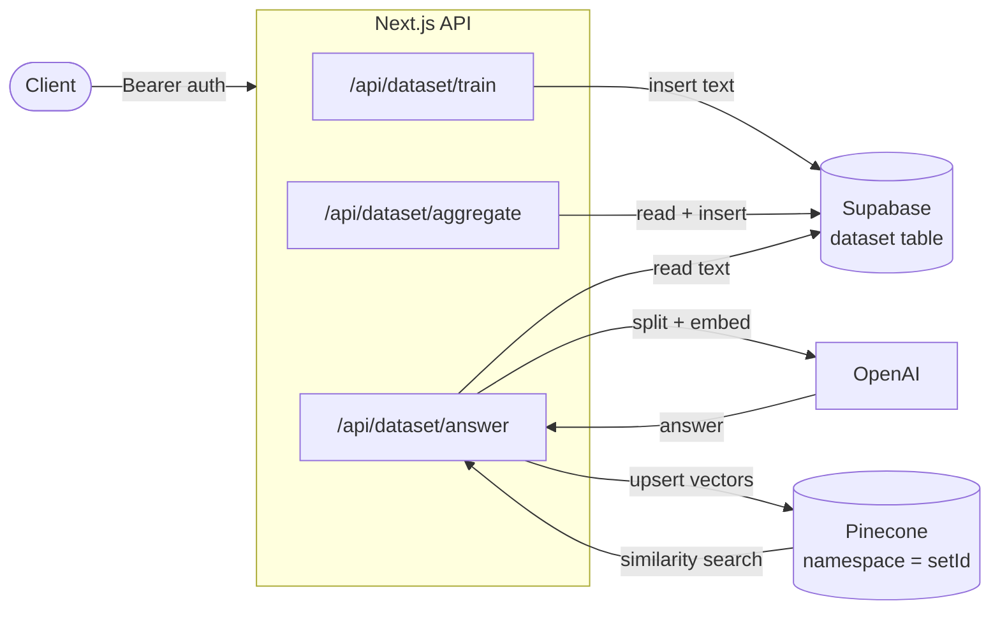

# VectorQA

**Retrieval-augmented question answering as a service — POST your documents, POST a question, get a grounded answer.**

VectorQA is an open-source backend that turns a pile of text into a question-answering system. It splits and embeds your documents with OpenAI, indexes the vectors in Pinecone, and answers natural-language questions with LangChain — behind a small, authenticated HTTP API.

No vector-store plumbing. No chunking or embedding boilerplate. No retrieval code to write.

[](https://nextjs.org)
[](https://www.typescriptlang.org)
[](https://js.langchain.com)
[](https://platform.openai.com)
[](https://www.pinecone.io)
[](https://supabase.com)
[](#license)

---

## Why VectorQA

Large language models don't know your data. The standard fix — retrieval-augmented generation (RAG) — is well understood but tedious to stand up: you need somewhere to store documents, a chunking strategy, an embedding pipeline, a vector index, and a chain that stitches retrieval to generation.

VectorQA factors that work into three endpoints:

- **Store** documents under a dataset ID (`train`).
- **Compose** new datasets out of existing ones (`aggregate`).
- **Ask** questions and get answers grounded in those documents (`answer`).

What makes it more than a demo:

- **Dataset isolation by design.** Each dataset lives in its own Pinecone namespace, so tenants, projects, or knowledge bases never bleed into each other's retrievals.
- **Composable knowledge.** `aggregate` lets you merge several datasets into one, so you can assemble a corpus from many sources before querying it.
- **Durable source of truth.** Documents live in Supabase Postgres; Pinecone is a rebuildable index over them. You are never locked into the vector store as your only copy of the data.
- **Typed, production-shaped code.** Generated Supabase database types, a single authenticated entry point, and configuration validated at boot.

---

## How it works

VectorQA has three moving parts: **Postgres** (Supabase) as the durable document store, **Pinecone** as the vector index, and **OpenAI** for embeddings and generation.



### The three stages

1. **Ingest — `train`.** You POST a `setId` and a block of `text`. It is written to the `dataset` table in Supabase. Nothing is embedded yet; storage and indexing are deliberately decoupled.

2. **Compose — `aggregate`.** You POST a list of existing dataset IDs and a new one. VectorQA reads every document in those datasets, concatenates their text, and writes the result as a single document in the new dataset. This is how you build a unified corpus out of many smaller ones.

3. **Answer — `answer`.** You POST a `setId` and a `question`. VectorQA:
   - loads all text for that dataset from Supabase,
   - splits it into overlapping-safe chunks with LangChain's `RecursiveCharacterTextSplitter` (1000-character chunks),
   - embeds the chunks with OpenAI's embedding model,
   - upserts them into a Pinecone namespace named after the dataset ID,
   - runs a LangChain `VectorDBQAChain` — retrieve the nearest chunks, then generate an answer with the LLM.

Because the namespace is the dataset ID, retrieval for one dataset can never surface another dataset's chunks.

---

## Use cases

- **Internal documentation assistant.** Train one dataset per repository or wiki space, then answer onboarding and "how do I…" questions over it.
- **Support knowledge base.** Continuously `train` resolved tickets into a dataset and expose `answer` to your support tooling so agents get grounded suggestions.
- **Multi-tenant knowledge sets.** Give every customer or workspace its own dataset ID. Namespace isolation means one tenant's documents are never retrieved for another's question.
- **Cross-source grounding.** Use `aggregate` to combine product docs, changelogs, and FAQs into a single dataset, then answer questions that span all of them.
- **Add Q&A to an existing product.** The API is plain HTTP + JSON, so you can bolt a "ask about this" feature onto any app without adopting a RAG framework.
- **Prototyping RAG pipelines.** Use VectorQA as a reference implementation or a backend you can iterate on while you evaluate vector databases and chain strategies.

---

## Architecture & design decisions

**Supabase Postgres is the system of record; Pinecone is a derived index.** Documents are stored as rows and only turned into vectors when a question is asked. This keeps the two concerns separable — you can re-index, change embedding models, or swap vector stores without migrating your corpus.

**One Pinecone namespace per dataset.** Isolation is structural rather than filtered: retrieval is scoped by namespace, so there is no query path that can leak documents across datasets.

**Boot-time configuration validation.** `lib/pinecone_client.ts` and `lib/pinecone_settings.ts` throw immediately if `PINECONE_API_KEY`, `PINECONE_ENVIRONMENT`, or `PINECONE_INDEX_NAME` is missing, so misconfiguration fails fast instead of at the first request.

**Module-level Pinecone client.** The client is initialized once as a module-level singleton using top-level `await` (enabled via the `topLevelAwait` webpack experiment in `next.config.js`), avoiding repeated handshakes on every request.

**Typed Supabase access.** `lib/client.ts` instantiates the Supabase client against a generated `Database` type (`lib/database.types.ts`), so queries are type-checked rather than stringly-typed.

**Single authentication chokepoint.** Every route calls one `authenticate` helper (`lib/auth.ts`) before doing any work, so there is exactly one place to audit and evolve the auth check.

### Project layout

```
pages/
  api/dataset/
    train.tsx       # POST — store a document in a dataset
    aggregate.tsx   # POST — merge datasets into a new one
    answer.tsx      # POST — embed, index, and answer a question
lib/
  auth.ts             # Bearer-token authentication
  client.ts           # Supabase client (service role, typed)
  database.types.ts   # Generated Supabase database types
  pinecone_client.ts  # Validated Pinecone singleton
  pinecone_settings.ts# Index name configuration
```

---

## API reference

All routes are `POST`, accept JSON, and require a bearer token:

```
Authorization: Bearer <SECRET_AUTH_KEY>
```

The base URL is your deployment origin (for local development, `http://localhost:3000`).

### `POST /api/dataset/train`

Store a document under a dataset ID.

**Body**

| Field | Type | Description |
|---|---|---|
| `setId` | string | Dataset to write into (also the Pinecone namespace used at query time) |
| `text` | string | Document content |

**Response**

```json
{
  "data": [{ "set_id": "product-docs", "text": "…", "id": 1 }],
  "error": null
}
```

### `POST /api/dataset/aggregate`

Merge the contents of several datasets into a new one.

**Body**

| Field | Type | Description |
|---|---|---|
| `setList` | string[] | Dataset IDs to read from |
| `newSet` | string | Dataset ID to write the merged text into |

**Response**

```json
{
  "data": [{ "set_id": "all-docs", "text": "…", "id": 2 }],
  "error": null
}
```

### `POST /api/dataset/answer`

Answer a natural-language question about a dataset.

**Body**

| Field | Type | Description |
|---|---|---|
| `setId` | string | Dataset to search |
| `question` | string | Question to answer |

**Response**

```json
{
  "answer": {
    "text": "…"
  }
}
```

### Examples

**curl**

```bash
# 1. Ingest two documents
curl -X POST http://localhost:3000/api/dataset/train \
  -H "Authorization: Bearer $SECRET_AUTH_KEY" \
  -H "Content-Type: application/json" \
  -d '{"setId":"product-docs","text":"VectorQA stores documents in Supabase and indexes them in Pinecone."}'

curl -X POST http://localhost:3000/api/dataset/train \
  -H "Authorization: Bearer $SECRET_AUTH_KEY" \
  -H "Content-Type: application/json" \
  -d '{"setId":"product-docs","text":"Questions are answered with a LangChain VectorDBQAChain."}'

# 2. Merge that dataset into a larger one
curl -X POST http://localhost:3000/api/dataset/aggregate \
  -H "Authorization: Bearer $SECRET_AUTH_KEY" \
  -H "Content-Type: application/json" \
  -d '{"setList":["product-docs"],"newSet":"all-docs"}'

# 3. Ask a question
curl -X POST http://localhost:3000/api/dataset/answer \
  -H "Authorization: Bearer $SECRET_AUTH_KEY" \
  -H "Content-Type: application/json" \
  -d '{"setId":"all-docs","question":"Where does VectorQA store documents?"}'
```

**JavaScript / TypeScript**

```ts
const BASE_URL = process.env.VECTORQA_URL ?? 'http://localhost:3000';
const KEY = process.env.SECRET_AUTH_KEY!;

async function call<T>(path: string, body: unknown): Promise<T> {
  const res = await fetch(`${BASE_URL}${path}`, {
    method: 'POST',
    headers: {
      'Authorization': `Bearer ${KEY}`,
      'Content-Type': 'application/json',
    },
    body: JSON.stringify(body),
  });
  if (!res.ok) throw new Error(`VectorQA ${res.status}`);
  return res.json() as Promise<T>;
}

const train = (setId: string, text: string) =>
  call('/api/dataset/train', { setId, text });

const aggregate = (setList: string[], newSet: string) =>
  call('/api/dataset/aggregate', { setList, newSet });

const answer = (setId: string, question: string) =>
  call<{ answer: { text: string } }>('/api/dataset/answer', { setId, question });

// Full flow: ingest → compose → ask
await train('product-docs', 'VectorQA stores documents in Supabase.');
await train('product-docs', 'Vectors are indexed in Pinecone namespaces.');
await aggregate(['product-docs'], 'all-docs');

const result = await answer('all-docs', 'Where are documents stored?');
console.log(result.answer.text);
```

**Python**

```python
import os
import requests

BASE_URL = os.environ.get("VECTORQA_URL", "http://localhost:3000")
KEY = os.environ["SECRET_AUTH_KEY"]
HEADERS = {"Authorization": f"Bearer {KEY}", "Content-Type": "application/json"}


def call(path: str, body: dict) -> dict:
    res = requests.post(f"{BASE_URL}{path}", json=body, headers=HEADERS, timeout=120)
    res.raise_for_status()
    return res.json()


call("/api/dataset/train", {"setId": "product-docs", "text": "VectorQA stores documents in Supabase."})
call("/api/dataset/train", {"setId": "product-docs", "text": "Vectors are indexed in Pinecone namespaces."})
call("/api/dataset/aggregate", {"setList": ["product-docs"], "newSet": "all-docs"})

result = call("/api/dataset/answer", {"setId": "all-docs", "question": "Where are documents stored?"})
print(result["answer"]["text"])
```

---

## Getting started

### Prerequisites

- **Node.js 18+** and npm
- An **OpenAI** API key (embeddings + completions)
- A **Pinecone** project, environment, and index
- A **Supabase** project (Postgres)

### 1. Create the Supabase table

VectorQA reads and writes a single `dataset` table. Create it in the Supabase SQL editor:

```sql
create table if not exists public.dataset (
  id         bigint generated by default as identity primary key,
  set_id     text not null,
  text       text not null,
  created_at timestamptz not null default now()
);

create index if not exists dataset_set_id_idx on public.dataset (set_id);
```

The server uses the **service role key**, which bypasses row-level security, so the table can stay locked down from the public API. Never expose this key to a browser or client app.

### 2. Create the Pinecone index

Create one index with these settings (they match OpenAI's `text-embedding-ada-002`, which produces 1536-dimensional vectors):

| Setting | Value |
|---|---|
| Dimensions | `1536` |
| Metric | `cosine` |

VectorQA creates a namespace inside this index per dataset ID — you only need the one index.

### 3. Configure environment variables

Create a `.env` file in the project root:

```dotenv
SUPABASE_URL=<your Supabase project URL>
SUPABASE_SERVICE_ROLE_KEY=<your Supabase service role key>
PINECONE_API_KEY=<your Pinecone API key>
PINECONE_ENVIRONMENT=<your Pinecone environment ID>
PINECONE_INDEX_NAME=<name of your Pinecone index>
OPENAI_API_KEY=<your OpenAI API key>
SECRET_AUTH_KEY=<a long random secret shared with your clients>
```

| Variable | Required | Purpose |
|---|---|---|
| `SUPABASE_URL` | ✅ | Supabase project URL |
| `SUPABASE_SERVICE_ROLE_KEY` | ✅ | Server-side Supabase key (bypasses RLS — keep secret) |
| `PINECONE_API_KEY` | ✅ | Pinecone API key |
| `PINECONE_ENVIRONMENT` | ✅ | Pinecone environment/region ID |
| `PINECONE_INDEX_NAME` | ✅ | Pinecone index that holds the vectors |
| `OPENAI_API_KEY` | ✅ | Embeddings + completions |
| `SECRET_AUTH_KEY` | ✅ | Bearer token your clients send |

### 4. Run it

```bash
npm install
npm run dev
```

The API is now at `http://localhost:3000`. If any required variable is missing, the app fails at startup with a specific error rather than at the first request.

Other scripts:

```bash
npm run build   # production build
npm run start   # run the production build
npm run debug   # dev server with the Node inspector attached
npm run lint    # ESLint
```

---

## Deployment

VectorQA is a standard Next.js app, so it deploys anywhere Node 18+ runs.

**Vercel.** Import the repository, add every variable from the table above in Project → Settings → Environment Variables, and deploy. No code changes are required.

**Any other host** (Railway, Render, Fly.io, a container, a VM). Build with `npm run build` and serve with `npm run start`, setting the same environment variables on the platform. Consult your platform's docs for how it injects secrets.

Set the variables on the server, never in the client bundle — this app has no client-side code that needs them.

---

## Authentication

Clients authenticate with a shared secret sent as a bearer token:

```
Authorization: Bearer <SECRET_AUTH_KEY>
```

`lib/auth.ts` compares the header against `process.env.SECRET_AUTH_KEY` on every request. Use a long, random value, rotate it if it leaks, and only give it to trusted server-side clients — anything holding it can read and write every dataset.

---

## Roadmap & known limitations

VectorQA is deliberately small, and this is what it does not do yet. Each item is a known follow-up rather than a hidden surprise:

- **Re-embedding on every question.** `answer` re-splits, re-embeds, and re-upserts the dataset each time it is called. This keeps the code simple and the index always in sync, but it adds latency and OpenAI cost per query. Incremental indexing at `train` time is the natural next step.
- **Flat error handling.** Every route wraps its work in a single `try/catch` that returns `401 Unauthorized`, so a Pinecone or OpenAI failure is indistinguishable from a bad token. Distinct status codes and error types are planned.
- **No request validation.** Request bodies are trusted. Schema validation (e.g. Zod) with `400` responses is planned.
- **Nested answer shape.** `answer` returns `{ "answer": { "text": "…" } }`. Flattening this to `{ "answer": "…" }` would make the API friendlier.
- **No method guard.** Routes read `req.body` without checking `req.method`; non-POST requests surface as `401`.
- **No UI or demo.** VectorQA is API-only today; the landing page is still the framework default.
- **No tests or CI.** A test suite covering the three routes and an authentication test are planned.
- **No streaming.** Answers are returned in one response; token streaming would improve perceived latency.
- **No delete/update route.** Documents can be appended and aggregated, but not yet edited or removed.

---

## Contributing

Issues and pull requests are welcome. A good starting point is any item in the roadmap above, particularly request validation and naming the root cause in error responses. Please run `npm run lint` before opening a PR.

---

## Acknowledgements

Prior art and inspiration:

- [mayooear/gpt4-pdf-chatbot-langchain](https://github.com/mayooear/gpt4-pdf-chatbot-langchain/)
- [bdcorps/langchain-pdf-qa](https://github.com/bdcorps/langchain-pdf-qa)

Built with [Next.js](https://nextjs.org), [LangChain](https://js.langchain.com), [OpenAI](https://platform.openai.com), [Pinecone](https://www.pinecone.io), and [Supabase](https://supabase.com).

---

## License

MIT © 2026 [Leonid Medovyy](https://github.com/leouofa)
